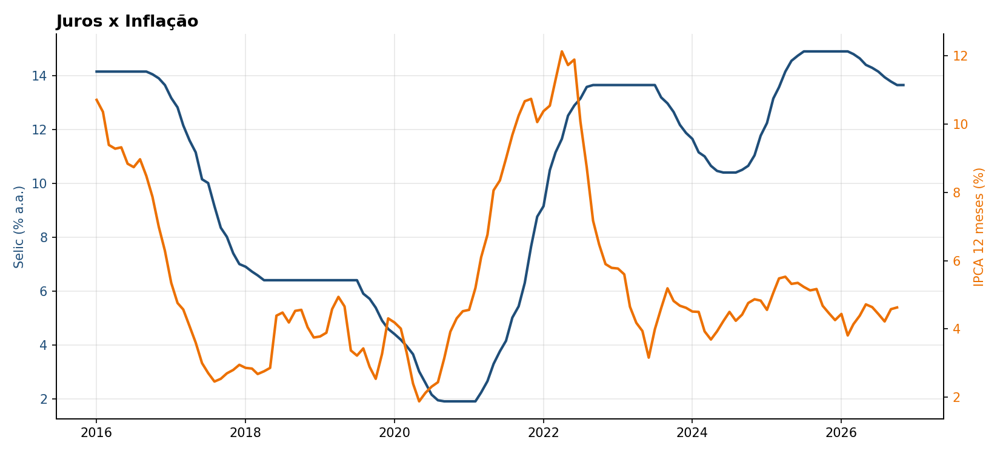
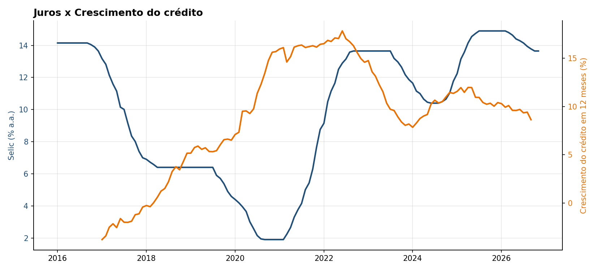
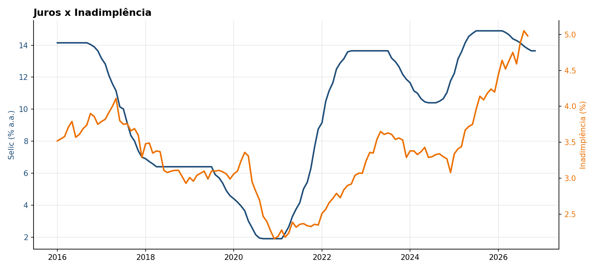

# 📊 Panorama de Juros e Crédito no Brasil

Projeto de análise de dados que investiga **como a taxa Selic se relaciona com a inflação, o crescimento do crédito e a inadimplência** no Brasil, usando dados públicos do Banco Central.

## 🎯 Perguntas de negócio

1. Quando os juros sobem, o crédito desacelera? Com quanto tempo de atraso?
2. Juros altos andam junto com inadimplência mais alta?
3. Em quais períodos o juro real (Selic menos inflação) foi mais alto?

## 🛠️ Ferramentas

| Etapa | Ferramenta |
|---|---|
| Coleta | Python (`requests`) + API SGS do Banco Central |
| Tratamento | Pandas |
| Armazenamento | Amazon S3 |
| Consultas | SQL no Amazon Athena (agregações, `CASE`, `LAG`, `corr`) |
| Visualização | Matplotlib |

```
API do Banco Central  →  Python/Pandas  →  CSV  →  Amazon S3  →  Amazon Athena (SQL)
                                              ↘  Matplotlib (gráficos)
```

## 📁 Estrutura

```
├── coleta.py          # baixa as séries do Banco Central e gera dados/panorama.csv
├── analise.py         # gera os gráficos e um resumo com os números principais
├── sql/athena.sql     # criação da tabela e consultas no Athena
├── dados/             # CSV gerado
└── graficos/          # imagens geradas
```

## ▶️ Como rodar

```bash
pip install -r requirements.txt
python coleta.py      # baixa os dados
python analise.py     # gera gráficos + resumo
```

**Na AWS:**
1. Crie um bucket no S3 e suba `dados/panorama.csv` na pasta `panorama/`.
2. No Athena, defina um local de resultados no S3 (Settings) e rode `sql/athena.sql`, trocando `SEU-BUCKET` pelo nome do bucket.

## 📈 Resultados





## 💡 Principais conclusões

Período analisado: jan/2016 a nov/2026 (131 meses).

**1. Os juros freiam o crédito, mas com cerca de 1 ano de atraso.**
A correlação entre a Selic e o crescimento do crédito é praticamente nula no mesmo mês (+0,05), mas fica negativa com 6 meses (-0,32) e mais forte com 12 meses (-0,59). Exemplo: depois que a Selic subiu de 1,90% (set/2020) para 13,75% (2022), o crescimento do crédito caiu de cerca de 17% ao ano em 2022 para perto de 8% no início de 2024.

**2. Juros altos andam junto com inadimplência mais alta, e o efeito aparece em uns 6 meses.**
A correlação entre Selic e inadimplência é alta já no mesmo mês (+0,70) e chega ao pico com 6 meses de defasagem (+0,86). A inadimplência foi de 2,16% (dez/2020, mínima da série, com juros na mínima) para 5,05% (ago/2026, máxima da série), depois de a Selic chegar a 14,90% em jul/2025.

**3. A Selic reagiu à inflação.**
Quando o IPCA acumulado em 12 meses passou de 10% em 2021–2022, o Banco Central elevou a Selic rapidamente. Com a inflação de volta à faixa de 4% a 5%, os juros começaram a cair em 2026 (13,65% em nov/2026).

**O que isso significa para um banco:** a Selic funciona como um *indicador antecedente*. Uma alta de juros hoje sinaliza crédito crescendo menos e maior risco de inadimplência nos meses seguintes, o que afeta decisões de precificação, oferta e provisão.

> ⚠️ Correlação não é causalidade: outros fatores (renda, emprego, programas emergenciais de 2020, renegociações) também influenciam esses indicadores. O objetivo aqui é exploratório.

## 🔜 Próximos passos

- Separar crédito de pessoa física e jurídica
- Automatizar a coleta mensal com AWS Lambda + Step Functions
- Montar um dashboard (QuickSight ou Power BI)

## 📚 Fonte dos dados

Banco Central do Brasil - Sistema Gerenciador de Séries Temporais (SGS): séries 4189, 13522, 20539 e 21082.

---
Feito por **Murilo Fidelis** - Ciência da Computação, Mackenzie
